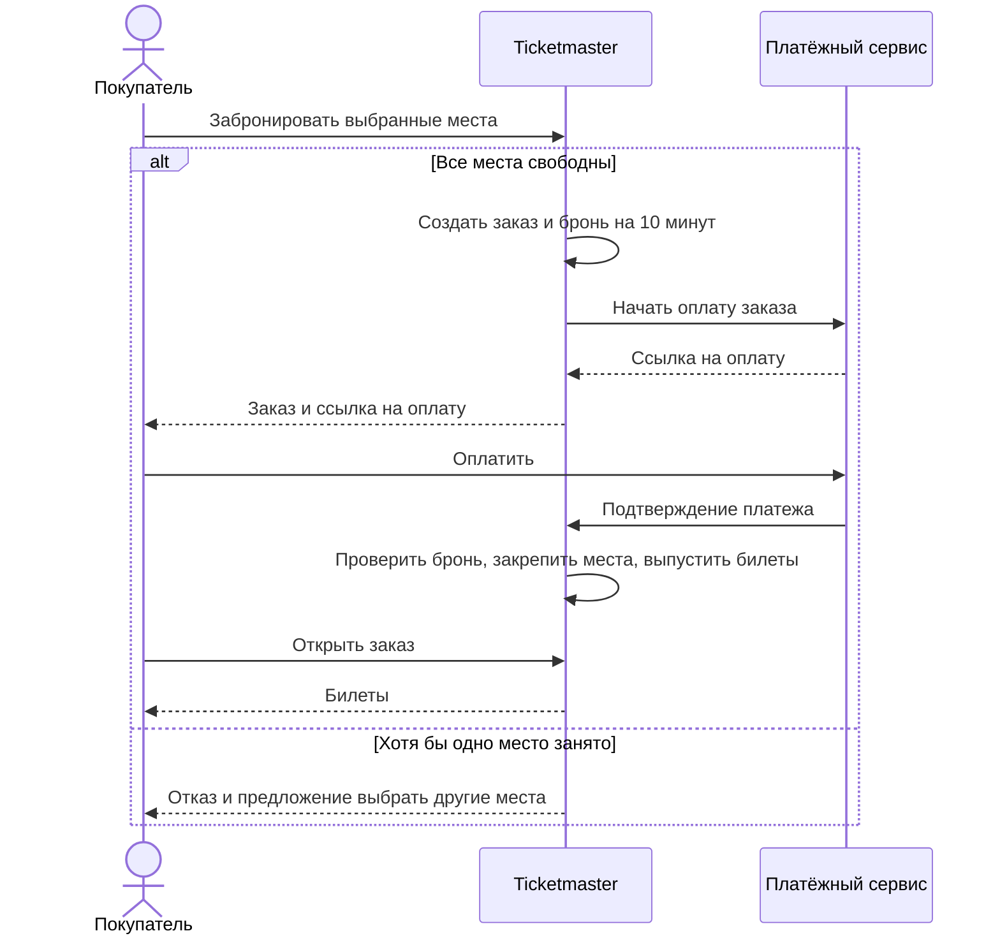

# Ticketmaster

Продажа билетов на концерты и мероприятия с выбором конкретных мест в зале.

## Границы проекта

Фиксированная схема зала, оплата через внешний платёжный сервис. Проверка билетов на входе, перепродажа и добровольные возвраты в первую версию не входят.

Масштаб и целевые показатели ниже — проектные допущения.

## Роли

| Роль        | Что делает                                                                                                          |
| ----------- | ------------------------------------------------------------------------------------------------------------------- |
| Покупатель  | Ищет мероприятие, выбирает и оплачивает места, получает билеты. Просмотр доступен без входа, покупка — после входа. |
| Организатор | Создаёт свои мероприятия, задаёт схему зала и цены, открывает продажу, смотрит проданные места.                     |

## Основные сценарии

| №   | Сценарий                             | Действия и результат                                                | Что создаёт нагрузку                                                    |
| --- | ------------------------------------ | ------------------------------------------------------------------- | ----------------------------------------------------------------------- |
| 1   | Найти мероприятие                    | Отфильтровать каталог по городу, дате и названию, открыть карточку. | Поиск, чтение списков и карточек.                                       |
| 2   | Выбрать места                        | Посмотреть цены и доступность на схеме, выбрать места.              | Чтение схемы и обновление статусов.                                     |
| 3   | **Купить билеты — главный сценарий** | Забронировать места, оплатить заказ, получить билеты.               | Конкуренция за одни места, запись броней и заказов, обработка платежей. |
| 4   | Получить купленные билеты            | Открыть свои заказы и скачать билеты.                               | Чтение заказов и выдача файлов перед мероприятием.                      |

### Главный сценарий

Бронь действует 10 минут, срок виден покупателю.

Если подтверждение оплаты не обработано за это время, заказ истекает и места освобождаются.

## Функциональные требования

1. Каталог: показывать опубликованные мероприятия с открытой продажей, фильтрами, датой, площадкой и диапазоном цен.
2. Места: показывать ряд, номер, цену и статус: свободно, забронировано или продано.
3. Заказ: бронировать все выбранные места либо ни одного, если хотя бы одно занято. Фиксировать сумму при создании заказа.
4. Оплата: проверять подлинность уведомления, заказ, сумму и результат платежа. Повтор запроса или уведомления не должен создавать дубликаты заказов, оплат и билетов.
5. Билеты: после подтверждения оплаты действующей брони выпускать билет с уникальным кодом на каждое место. Покупатель видит только свои заказы и билеты, может скачать их повторно.
6. Управление: организатор редактирует и публикует только свои мероприятия, видит забронированные и проданные места. После открытия продаж схема зала не меняется, новые цены применяются только к новым заказам.

## Нефункциональные требования

### Нагрузка и задержки

Расчётный пик — 10 000 активных покупателей / 15 минут после открытия продаж:

- Обновление мест раз в 10 секунд: 10 000 / 10 = 1 000 RPS
- Каталог или карточка раз в 30 секунд: 10 000 / 30 ≈ 334 RPS
- Создание заказов: 20 попыток/с; подтверждение оплаты: до 20 RPS
- Получение билетов: 50 RPS

Половина запросов выбора и покупки приходится на одно мероприятие.

Задержки проверяются при этом пике, от получения запроса сервером до ответа, включая вызовы зависимостей. Время действий покупателя и ожидания решения банка не учитывается.

| Сценарий / операция                                     |    p50 |      p95 |      p99 |
| ------------------------------------------------------- | -----: | -------: | -------: |
| 1. Запрос каталога или карточки                         | 100 мс |   300 мс |   700 мс |
| 2. Получение схемы или обновление доступности           | 150 мс |   400 мс |   800 мс |
| 3. Создание заказа, брони и ссылки на оплату            | 300 мс |   800 мс | 2 000 мс |
| 3. Обработка подтверждения оплаты до готовности билетов | 200 мс |   700 мс | 2 000 мс |
| 4. Получение списка заказов или скачивание билета       | 100 мс |   300 мс |   700 мс |
| Управление: сохранение или публикация мероприятия       | 300 мс | 1 000 мс | 2 000 мс |

### Доступность

- 99,9% за месяц для каждого основного сценария, включая плановые работы и сбои платёжного сервиса. За 30 дней допустимо 43 минуты 12 секунд недоступности.
- Проверка — раз в минуту по каждой операции. Ошибки сервера и тайм-ауты считаются отказами, ответ "место занято" — нет.
- При сбое оплаты каталог и ранее купленные билеты остаются доступны.

### Согласованность

- На место в конкретном мероприятии допустимы не более одной действующей брони и не более одного оплаченного билета. Проданное место бронировать нельзя. Проверка доступности и создание брони атомарны.
- Подтверждение оплаты и истечение брони обрабатываются последовательно для каждого заказа, истёкший заказ нельзя перевести в оплаченный.
- Допустимое отставание статусов мест — 10 секунд, каталога — 60 секунд. После подтверждённой записи заказ читается без отставания.
- При потере уведомления об оплате сверять результат с платёжным сервисом каждые 60 секунд, при его сбое повторить сверку после восстановления.

### Сохранность и восстановление

- RPO = 0 для подтверждённых заказов, платежей и билетов при отказе узла или зоны: запись подтверждается после сохранения в двух независимых зонах.
- Перезапуск сервиса не сбрасывает действующие брони.
- Резервные копии и журнал изменений хранятся 30 дней, обеспечивают RPO <= 15 минут при повреждении данных или потере региона. До возобновления продаж нужно сверить платежи и восстановить оплаченные заказы.
- RTO <= 30 минут. Восстановление из копии проверяется ежемесячно.

P.S.: RPO — допустимая потеря данных по времени, RTO — время восстановления.

### География

- Пользователи — в России. Основная система — в одном регионе, минимум в двух зонах доступности, резервные копии — во втором регионе России.
- Запись заказов ведётся только в основном регионе. При невозможности надёжно сохранить бронь покупка недоступна.
- Автоматическое переключение между регионами в первую версию не входит.
